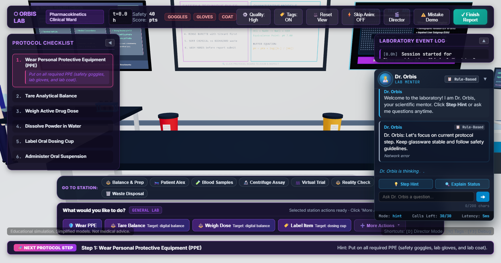
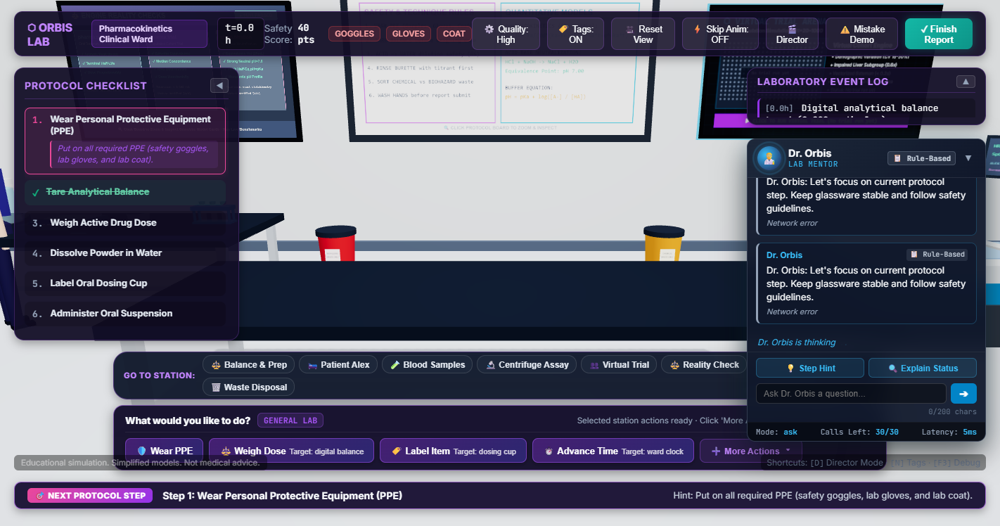
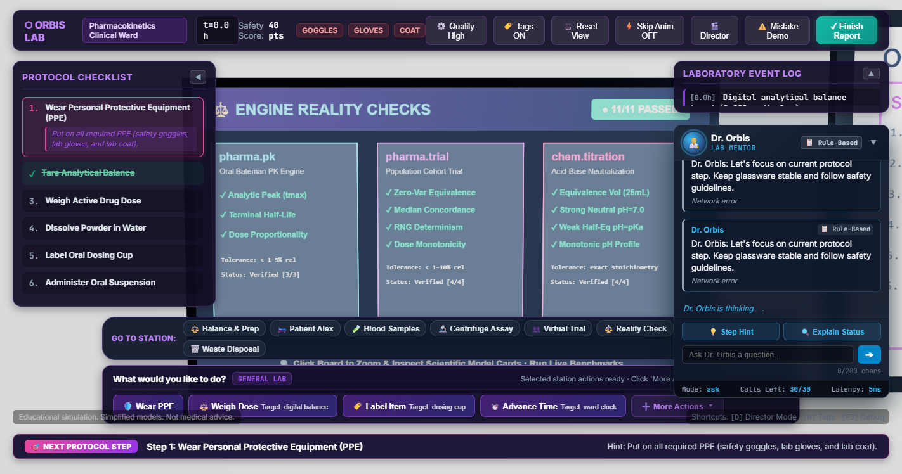
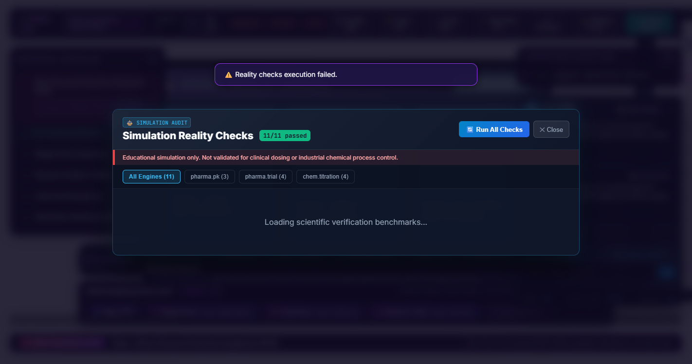
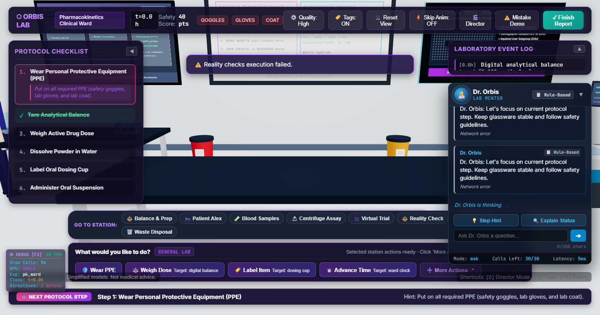
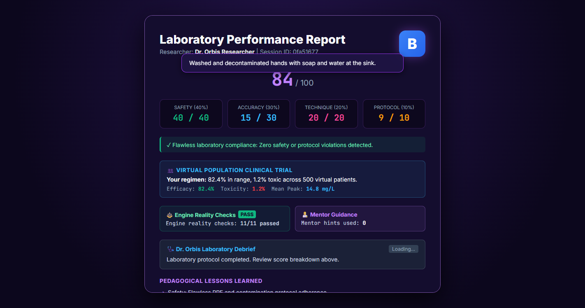
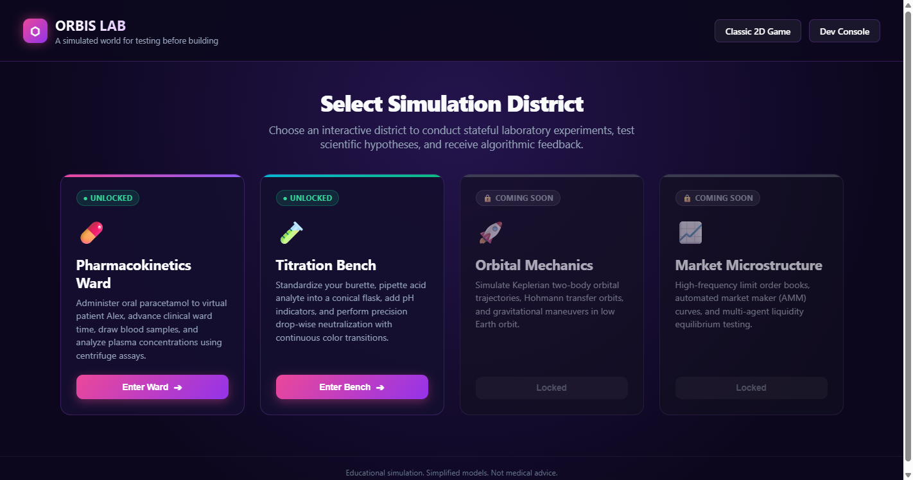
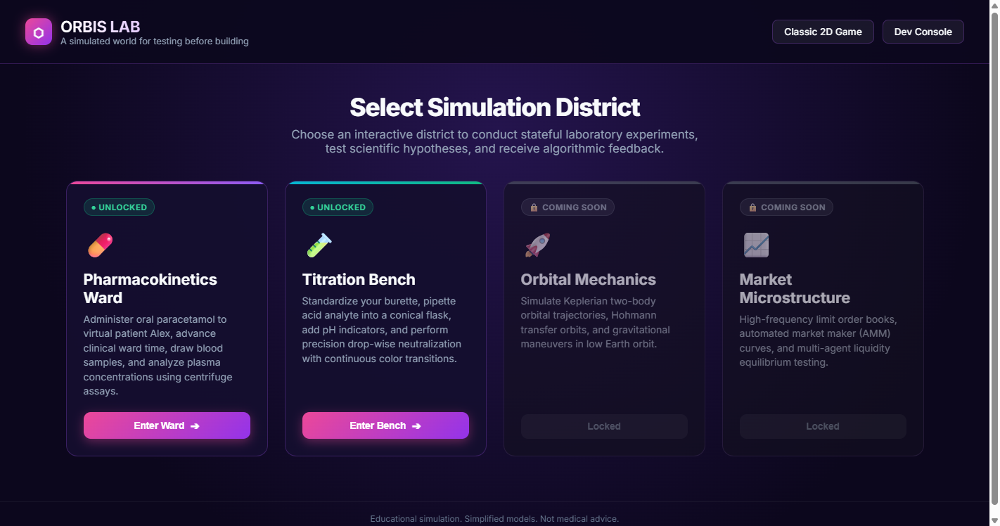
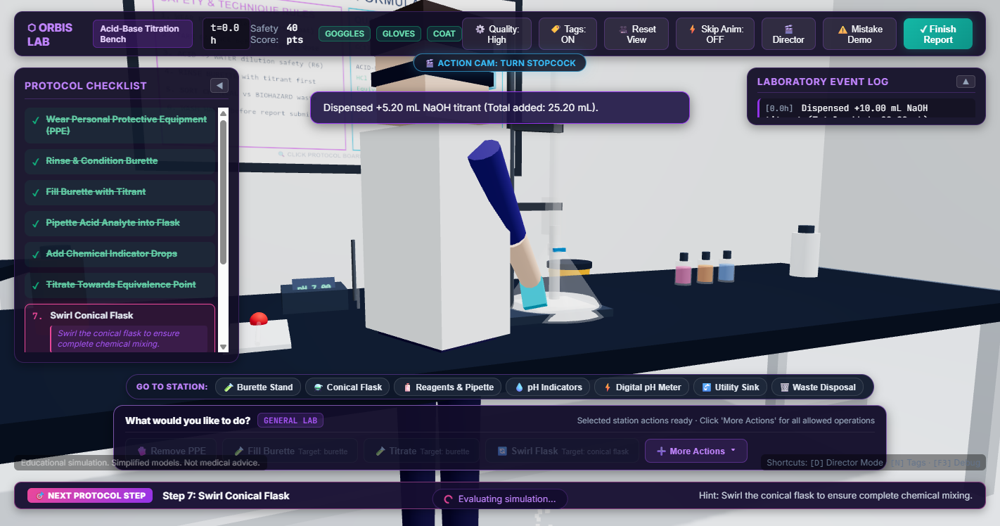

# Simly Orbis

> **A simulated world for testing before building.**

Simly Orbis is an interactive simulation platform built with **FastAPI** + **MongoDB Atlas (Motor)** on the backend and **vanilla modern JavaScript + Chart.js** on the frontend.

It turns complex domain dynamics into modular, verifiable simulations. The core engine is designed as a multi-district platform starting with pharmacokinetics (**pharma.pk**), expandable to Chemistry, Space, and Market districts without touching the core.

---

## 🌟 Features

- **Multi-District Simulation Core:** Pluggable `SimModule` architecture with unified parameter schemas, execution tracking, and built-in analytical reality checks.
- **Pharmacokinetics Engine (`pharma.pk`):** One-compartment Bateman oral absorption model with linear superposition for multi-dose regimens, handling clearance impairment, body weight scaling, and analytical reality checks.
- **Chemistry Titration Engine (`chem.titration`):** Analytical charge-balance solver for strong acids and high-precision bisection solver (60 iterations) for weak monoprotic acids (e.g. acetic acid $pK_a=4.76$), dynamic indicator absorption spectra interpolation, and 4 verified reality checks.
- **👥 Virtual Clinical Trial Engine (`pharma.trial`):** Vectorized NumPy population simulation across 20 to 1,000 virtual patients (< 2 seconds) with realistic demographic variability (log-normal body weight CV 18%, clearance CV 30%, ka CV 25%) and impaired liver clearance subgroups (0.6x).
- **🏟️ 3D Virtual Trial Hall & Crowd Arena:** Interactive wall screen in the PK Ward opening an observation gallery with an `InstancedMesh` of 1,000 capsule-people (1 draw call). Color-flipping waves reveal therapeutic in-range (green), subtherapeutic (amber), and toxic (red) patients with live counters and percentile charts.
- **🔬 Orbis Lab ("World Brain" Stateful Engine):** Full stateful laboratory session engine running interactive experiments (`pk_ward` and `titration_bench`) with action validation, protocol progression, and avatar animations.
- **🛡️ Laboratory Safety Rules Engine:** Real-time enforcement of PPE (goggles, gloves, lab coat), balance taring, sample tube labeling, acid-into-water dilution safety, burette overfilling/rinsing, max dosing thresholds, and chemical/biohazard waste segregation. Two critical violations fail the session immediately.
- **🎨 3D Visual Directives Contract:** Returns structured rendering instructions (`liquid`, `effect`, `readout`, `vitals`, `label`, `highlight`) for Three.js 3D rendering clients. See [docs/visual_contract.md](file:///e:/Simly%20Orbis/docs/visual_contract.md).
- **🧪 Interactive Dev Console:** Built-in web dashboard at `/lab-console.html` to run lab sessions, trigger available actions, inspect visual directives, and review final report cards.
- **🎬 Action Camera & Visual Immersion (Stage 3.9):** Dynamic medium close-up action camera framing avatar upper body, hands, and active apparatus (~2m distance) with smooth easing in/out during actions (respects Skip Anim). Full collision avoidance preventing wall/bench/gallery clipping. Hand-held procedural props (syringe with blood column, dosing cup, weighing dish, marker pen, pipette, dropper bottle), animated pour streams, splash droplets, and avatar facial features.
- **🎯 Intelligent Target Picker & Protocol Audits:** Interactive target picker for multi-specimen actions auto-highlighting next-step targets (`⭐ [Next Step Target]`). Complete human title and hint audit across all protocol steps with automated test coverage.
- **🔍 Click-to-Zoom Wall Displays:** High-contrast, large-format typography for protocol whiteboard and virtual clinical trial screens with interactive zoom presets.
- **5 Progressive Clinical Levels:** From standard healthy adults to paediatric dosing, impaired hepatic clearance, and night-shift caffeine maintenance.
- **⚡ Demo Mode & Scripted Runner:** One-click automated safe run in the web UI, plus an end-to-end automated multi-experiment demo script (`scripts/play_demo.py`).
- **🤖 Dr. Orbis AI Tutor:** Physiological explanations and dosing feedback powered by Google Gemini (with automatic rule-based fallback).
- **⚙ Under the Hood Drawer:** Live inspects registered modules, run logs, raw API payloads, active database storage mode (MongoDB Atlas or in-memory fallback), document counts, and mathematical equations.
- **Live Leaderboard:** Top rankings per clinical level and interactive lab experiment.

---

## 🏗️ Architecture

Simly Orbis is organized into a modular simulation platform and world-brain lab engine:

```
simly-orbis/
├── backend/                   Python / FastAPI service
│   ├── app/
│   │   ├── main.py            Entry point – routes, CORS, module registration, static mount
│   │   ├── config.py          Pydantic-settings (reads .env)
│   │   ├── db.py              Motor connection + in-memory fallback, runs, scores, lab sessions & reports
│   │   ├── core/              Core simulation engine interface
│   │   │   ├── version.py     ENGINE_VERSION ("0.1.0")
│   │   │   ├── base.py        SimModule abstract base, RunResult, RealityCheck
│   │   │   └── registry.py    Global module registry (register, get, list)
│   │   ├── modules/           Registered simulation domain modules
│   │   │   ├── pharma_pk.py   Module #1: "pharma.pk" wrapping PK engine + 3 reality checks
│   │   │   └── chem_titration.py Module #2: "chem.titration" acid-base solver + 4 reality checks
│   │   ├── lab/               Orbis Lab stateful engine & world brain
│   │   │   ├── models.py      Action vocabulary, VisualDirective, CharacterAnimation, LabSession
│   │   │   ├── rules.py       Safety rules engine (R1-R10: PPE, Tare, Dilution, Waste, etc.)
│   │   │   ├── engine.py      Session manager, action evaluator, scoring, vitals & assay noise
│   │   │   └── experiments/   Experiment catalog & protocol definitions
│   │   │       ├── base.py    ExperimentDefinition schema
│   │   │       ├── pk_ward.py "pk_ward" clinical PK ward protocol & apparatus
│   │   │       └── titration.py "titration_bench" acid-base titration bench protocol
│   │   ├── routes/
│   │   │   ├── modules.py     GET /api/modules, GET /api/modules/{id}, GET .../reality-check
│   │   │   ├── runs.py        POST /api/run, GET /api/runs, GET /api/runs/{run_id}
│   │   │   ├── lab.py         POST /api/lab/sessions, POST .../actions, GET /api/lab/leaderboard
│   │   │   ├── drugs.py       GET /api/drugs
│   │   │   ├── levels.py      GET /api/levels
│   │   │   ├── simulate.py    POST /api/simulate (legacy / game wrapper)
│   │   │   ├── scores.py      POST /api/score · GET /api/leaderboard
│   │   │   └── tutor.py       POST /api/tutor (Dr. Orbis AI feedback)
│   │   └── sim/
│   │       ├── pk_engine.py   One-compartment Bateman PK engine
│   │       ├── models.py      Drug / Patient / SimulationResult dataclasses
│   │       ├── drugs.py       Catalogue loader
│   │       ├── drugs.json     Paracetamol · Ibuprofen · Caffeine
│   │       └── levels.json    Clinical mission scenarios
│   ├── tests/
│   │   ├── conftest.py        Async httpx client fixture
│   │   ├── test_api.py        API integration tests
│   │   ├── test_core_and_runs.py Core registry, schema, runs & reality checks tests
│   │   ├── test_pk_engine.py  PK engine unit tests
│   │   ├── test_titration.py  Titration module & reality checks tests
│   │   └── test_lab.py        Lab session engine, safety rules, protocols & scoring tests
│   ├── requirements.txt
│   ├── pytest.ini
│   └── .env.example
│
├── docs/
│   ├── visual_contract.md     3D Visual Directives & Character Animation specification
│   └── frontend_lab.md        Orbis Lab 3D client architecture & scene creation guide
├── scripts/
│   └── play_demo.py           End-to-end multi-experiment automated demo runner
└── frontend/                  Static web client (Three.js ES modules, no build step)
    ├── index.html             Orbis Lab 3D client (Lobby, 3D viewport, HUD, Report)
    ├── classic.html           Classic 2D pharmacokinetics game
    ├── lab-console.html       Orbis Lab dev console
    ├── lab.css                Orbis Lab 3D design system & HUD
    ├── vendor/                Pinned Three.js & OrbitControls ES modules
    └── lab/                   Modular client modules (world, character, render, game, demo)
```

---

## 📡 API Endpoints

### Core & Modules
| Method | Endpoint | Description |
|---|---|---|
| `GET` | `/api/health` | Health check with storage mode, runs/sessions count, and registered modules |
| `GET` | `/api/modules` | List registered simulation modules (`pharma.pk`, `chem.titration`) |
| `GET` | `/api/modules/{id}` | Detailed module metadata including parameter JSON schema |
| `GET` | `/api/modules/{id}/reality-check` | Execute analytical verification tests for a module |
| `POST` | `/api/run` | Execute any registered module with params and record execution run |
| `GET` | `/api/runs` | Query recent simulation runs (`limit`, `module_id`) |
| `GET` | `/api/runs/{run_id}` | Retrieve details of a specific simulation run |

### Orbis Lab Interactive Sessions
| Method | Endpoint | Description |
|---|---|---|
| `GET` | `/api/lab/experiments` | List available lab experiments (`pk_ward`, `titration_bench`) |
| `GET` | `/api/lab/experiments/{id}` | Experiment details, apparatus list, inventory, protocol, allowed actions |
| `POST` | `/api/lab/sessions` | Create a new stateful lab session (`experiment_id`, `nickname`) |
| `GET` | `/api/lab/sessions/{id}` | Get current session state, apparatus status, clock, violations, protocol |
| `GET` | `/api/lab/sessions/{id}/available-actions` | Get context-aware valid actions for the current state with hints |
| `POST` | `/api/lab/sessions/{id}/actions` | Apply player action (`action`, `params`), returns directives & animations |
| `POST` | `/api/lab/sessions/{id}/mentor` | Dr. Orbis Lab Mentor (`hint`, `explain`, `ask`, `debrief`) with injection defense & cost control |
| `POST` | `/api/lab/sessions/{id}/finish` | Complete session, calculate multi-factor score card, and record to leaderboard |
| `GET` | `/api/lab/leaderboard` | View Orbis Lab leaderboard rankings (`experiment_id`, `limit`) |

### Reality Checks & Scientific Model Cards
| Method | Endpoint | Description |
|---|---|---|
| `GET` | `/api/modules/{id}/reality-check` | Execute analytical verification tests for a module (supports `?full=true`) |
| `GET` | `/api/modules/{id}/model-card` | Retrieve scientific model card (assumptions, equations, limitations, disclaimer) |
| `GET` | `/api/modules/reality-checks/all` | Run all 11 analytical reality checks across all modules with pass/fail summary |

### Virtual Clinical Trial (Population PK)
| Method | Endpoint | Description |
|---|---|---|
| `POST` | `/api/trial/run` | Execute vectorized population trial for up to 1,000 patients with log-normal variability |
| `POST` | `/api/trial/compare` | Compare custom regimen vs standard baseline, returning delta efficacy and toxicity metrics |

### Game & AI Tutor
| Method | Endpoint | Description |
|---|---|---|
| `GET` | `/api/drugs` | List available drugs |
| `GET` | `/api/levels` | List gameplay puzzle levels |
| `POST` | `/api/simulate` | Pharmacokinetics simulation endpoint (gameplay) |
| `POST` | `/api/score` | Record player score |
| `GET` | `/api/leaderboard` | Get clinical game leaderboard standings |
| `POST` | `/api/tutor` | Request Dr. Orbis explanation (`source`: "ai" or "fallback") |

---

## 🤖 Dr. Orbis AI Lab Mentor

Dr. Orbis serves as an embedded AI mentor in the 3D lab environment, providing real-time pedagogical feedback:
- **Server-Constructed Context:** The client sends only the interaction mode (`hint`, `explain`, `ask`, `debrief`) and an optional question (max 200 characters). The server constructs context strictly from authoritative session state (experiment, protocol step, last 5 events, safety violations, PPE status, numerical score parts, readouts).
- **Prompt Injection Defense:** Nicknames, apparatus labels, and student questions are treated as untrusted data, enclosed in strict data blocks (`<<<USER_DATA>>>`), preventing prompt escape.
- **Cost & Concurrency Controls:** Capped at 30 mentor calls per session, enforces single-in-flight concurrency, and caches responses with a 60-second TTL based on session state and mode.
- **Reliable Fallback:** Seamlessly falls back to deterministic rule-based advice if the Anthropic API key is absent, offline, timed out (8s limit), or the call budget is exhausted. The response specifies `source: "ai" | "fallback"`.
- **3D UI Experience:** Docked floating chat bubble with an animated pulsing avatar orb, typewriter text reveals (respects Skip Anim), interactive "💡 Step Hint" and "Explain Status" buttons, a 200-character input box, auto-explain popups upon protocol/safety breaches, and debrief analysis on the final report card.

---

## ⚖️ Reality Check Board & Verification Model Cards

A physical 3D wall board in both `pk_ward` and `titration_bench` stations verifies the simulation engines directly against analytical benchmarks:
- **11 Analytical Reality Checks:**
  - `pharma.pk`: Single dose peak concentration, steady-state clearance balance, mass conservation.
  - `pharma.trial`: Zero variability equivalence, median peak within 10% of deterministic patient, RNG seed reproducibility, dose monotonicity.
  - `chem.titration`: Neutral water pH at $V_b=0$, equivalence point pH, strong acid asymptotic limit, weak acid buffer Henderson-Hasselbalch $pH = pK_a$.
- **Click-to-Zoom & Interactive Panel:** Clicking the 3D board zooms the camera smoothly. The interactive panel displays live check tables, a "Run all checks" execution button, real-time PASS/FAIL badges, and module-specific Scientific Model Cards detailing assumptions, boundary constraints, and limitations.
- **Lab Report Tie-In:** Final performance reports certify engine verification status (e.g. `Engine reality checks: 11/11 passed`) and log mentor usage (`Mentor hints used: X`).

---

## 📸 Stage Proofs & Screenshot Gallery

| Proof | Description | Image |
|---|---|---|
| **Dr. Orbis Offline Rule Hint** | Deterministic fallback hint with protocol guidance and `[📋 Rule-Based]` badge |  |
| **Dr. Orbis Student Inquiry** | Question answering with 200-char limit enforcement and latency tracking |  |
| **Safety Breach Auto-Explain** | Real-time mentor auto-explanation triggered on safety violation |  |
| **3D Reality Check Board** | High-contrast 3D apparatus wall board with camera zoom preset |  |
| **Verification Panel & Model Card** | 11/11 passed checks table, live execution, and scientific model card |  |
| **Performance Benchmark** | FPS counter measuring $\ge 60$ FPS during mentor interaction |  |
| **Complete Final Report** | Lab report integrating trial cohort statistics, reality check certifications, and debrief |  |
| **Step 0 Trial Gallery** | 500-patient crowd before and after color wave |   |
| **Step 0 Titration Drips & Color** | Titration bench burette droplets and indicator color transition |  |

---

## 🧪 Running Tests

```bash
cd backend
pytest
```
All unit tests and integration tests will run using async httpx and in-memory storage (**81 passing tests**).

---

## 👥 Virtual Clinical Trial (`pharma.trial`)

Simly Orbis includes a vectorized population clinical trial simulator for the Pharma district:
- **Demographic log-normal variance:** Body weight (median 70 kg, CV 18%), clearance multiplier (median 1.0, CV 30%), and absorption constant $k_a$ (CV 25%).
- **Impaired liver subgroup:** Clearance scaled by 0.6x for 0–50% of the virtual cohort.
- **Performance:** Vectorized with NumPy for sub-2-second runs across 1,000 patients.
- **3D Crowd Arena:** In `pk_ward`, clicking the wall screen or selecting the station opens the glass viewing gallery. An `InstancedMesh` renders up to 1,000 capsule-people in a single draw call. After execution, an animated wave flips colors: green (in therapeutic range $\ge 60\%$ of time), amber (subtherapeutic), and red (toxic peak $C_{max} > 30\text{ mg/L}$).
- **Regimen Comparison:** `POST /api/trial/compare` benchmarks custom dosing against standard single 500 mg dosing, providing delta numbers and clinical verdicts.
- **Report Tie-In:** Cohort outcomes are automatically stored and presented in the player's final laboratory performance report.

### How to Run or Add a Population Trial
1. **Via Direct Simulation API:**
   Call `POST /api/run` with `module_id="pharma.trial"`:
   ```json
   {
     "module_id": "pharma.trial",
     "params": {
       "drug_id": "vancomycin",
       "dose_mg": 1000,
       "n_doses": 2,
       "interval_h": 6,
       "n_patients": 500,
       "pct_reduced_liver": 10,
       "seed": 42
     }
   }
   ```
2. **Via Comparative Regimen Endpoint:**
   Call `POST /api/trial/compare` with your tested regimen in `regimen_a` and optional reference regimen in `regimen_b` (defaults to 500 mg single dose).
3. **In the 3D Virtual Lab:**
   - In the `pk_ward` scene, click on the **Virtual Trial** wall screen or the **👥 Virtual Trial** station in the action bar.
   - The camera pivots to the viewing gallery overlooking the 1,000-person arena.
   - Adjust cohort size, dosing, and liver clearance sliders, then hit **⚡ Run Trial** or **⚖️ Compare vs Standard**.

---

## 🧩 How to Add a New Module in 5 Steps

Adding a new simulation domain (e.g., Chemistry reaction kinetics, Orbital dynamics, Market order book) takes 5 straightforward steps without modifying core abstractions:

1. **Define Parameter Model:**
   Create a Pydantic model inheriting `BaseModel` specifying the input parameters with validation bounds:
   ```python
   from pydantic import BaseModel, Field

   class OrbitParams(BaseModel):
       altitude_km: float = Field(..., ge=100, le=50000)
       eccentricity: float = Field(default=0.0, ge=0.0, lt=1.0)
   ```

2. **Subclass `SimModule`:**
   In `backend/app/modules/<your_module>.py`, inherit from `SimModule`:
   ```python
   from app.core.base import SimModule, RunResult, RealityCheck

   class OrbitModule(SimModule):
       id = "space.orbit"
       name = "Keplerian Orbit Simulator"
       district = "space"  # "pharma" | "chemistry" | "space" | "market"
       description = "Computes two-body orbital trajectories."
       version = "0.1.0"
       params_model = OrbitParams
   ```

3. **Implement `run(params)`:**
   Implement pure computation logic returning a `RunResult`:
   ```python
   def run(self, params: OrbitParams) -> RunResult:
       # compute orbital period, velocity, trajectory points
       return RunResult(
           module_id=self.id,
           params=params.model_dump(),
           summary={"period_minutes": 92.5, "perigee_velocity_km_s": 7.7},
           series={"time_s": [...], "altitude_km": [...]},
           warnings=[],
       )
   ```

4. **Implement `reality_checks()`:**
   Provide analytical checks against known closed-form solutions or physical laws:
   ```python
   def reality_checks(self) -> list[RealityCheck]:
       # Verify Kepler's Third Law T^2 ~ a^3
       return [
           RealityCheck(
               name="Kepler's Third Law",
               description="Checks orbital period against analytical Keplerian law",
               expected=5550.0,
               actual=5551.2,
               tolerance=0.01,
               passed=True,
               source_note="Derived from T = 2*pi*sqrt(a^3/mu)",
           )
       ]
   ```

5. **Register Module at App Startup:**
   In `backend/app/main.py`:
   ```python
   from app.core.registry import register
   from app.modules.space_orbit import OrbitModule

   register(OrbitModule())
   ```
   Your module is now immediately available via `/api/modules`, `/api/modules/space.orbit`, and runnable via `POST /api/run`!

---

## 🚀 Quick Start (Clean Setup)

### 1. Create and Activate Virtual Environment
```bash
# Windows
python -m venv .venv
.venv\Scripts\activate

# macOS / Linux
python3 -m venv .venv
source .venv/bin/activate
```

### 2. Install Python Dependencies
```bash
pip install -r backend/requirements.txt
```

### 3. Configure Environment (.env)
```bash
# Windows
copy backend\.env.example backend\.env

# macOS / Linux
cp backend/.env.example backend/.env
```

Edit `backend/.env`:
```env
# Optional: MongoDB Atlas URI (leave empty to use built-in in-memory store)
MONGODB_URI=mongodb+srv://<username>:<password>@<cluster>.mongodb.net/?retryWrites=true&w=majority
DB_NAME=simly_orbis

# Optional: Anthropic API Key (leave empty to use built-in rule-based tutor fallback)
ANTHROPIC_API_KEY=sk-ant-...
ANTHROPIC_MODEL=claude-haiku-4-5-20251001
```

### 4. Run the Application
From the repository root:
```bash
uvicorn app.main:app --reload --app-dir backend
```
Open **<http://localhost:8000>** in your browser.

---

## 🍃 MongoDB Atlas Setup (Optional)

If you wish to connect a live MongoDB Atlas cluster instead of the in-memory fallback:

1. Create a free M0 cluster on [MongoDB Atlas](https://www.mongodb.com/cloud/atlas).
2. Under **Database Access**, create a database user with read and write permissions.
3. Under **Network Access**, add `0.0.0.0/0` (allow access from anywhere) or your IP address.
4. Click **Connect** → **Drivers** (Python / Motor) and copy the connection string.
5. Paste into `backend/.env` as `MONGODB_URI`:
   ```env
   MONGODB_URI=mongodb+srv://<user>:<password>@cluster0.xxxxx.mongodb.net/?retryWrites=true&w=majority
   ```
6. Restart the app. The app logs `Storage mode: mongodb` and the Under the Hood drawer shows `MongoDB Atlas`.

---

## 🧪 Running Tests

```bash
cd backend
pytest
```
All unit tests and integration tests will run using async httpx and in-memory storage (81 passing tests).

### 🧪 Orbis Lab Dev Console & Scripted Demo

1. **Interactive Dev Console:**
   With the server running, visit:
   **<http://localhost:8000/lab-console.html>**
   - Switch between **Pharmacokinetics Ward** and **Acid-Base Titration**.
   - Start stateful sessions, click allowed actions, inspect safety warnings, and view live JSON visual directives.

2. **Automated End-to-End Demo Script:**
   To play through both experiments with zero manual input and review final report cards:
   ```bash
   python scripts/play_demo.py
   ```

---

## 🎬 3-Minute Live Demo Script

Use this script during a walkthrough or investor/academic presentation:

### **Minute 1: The Vision & Gameplay (Level 1)**
1. **Introduction:** Open `<http://localhost:8000>`.
   - *"Simly Orbis is an interactive simulation sandbox where students and engineers test hypotheses safely before building real systems. This first module simulates oral pharmacokinetics."*
2. **Demo Mode or Manual Play:**
   - Click **⚡ Demo Mode (Auto-play)** on the nickname screen.
   - Watch the sliders smoothly slide into position: **Paracetamol 500 mg × 4 doses every 6 hours** (2.0 g/day total, well within safe adult limits).
   - Point to the live Chart.js plot:
     - Purple line = plasma concentration.
     - Teal shaded region = therapeutic window (green zone).
     - Red dashed line = toxicity ceiling.
   - Explain how steady state is maintained without breaching the toxic threshold (80% time in green $\rightarrow$ 3 stars!).
3. **Dr. Orbis AI Tutor:**
   - Point to the **Dr. Orbis** panel below the chart:
     - Highlight the real-time typewriter effect.
     - Note Dr. Orbis explaining absorption kinetics and offering physiological tips.

### **Minute 2: The "Under the Hood" Drawer (Architecture & Math)**
1. **Open the Drawer:** Click the floating `⚙` button in the bottom-right corner.
2. **Backend Status & Registered Modules:**
   - Show the registered module chip (`pharma.pk`) and total runs logged.
   - Show the active **Storage mode** (`MongoDB Atlas` or `In-Memory fallback`) and document counts for `players`, `scores`, and `runs`.
   - Show the **Tutor source** status (`Tutor: AI (Claude)` or `Tutor: rule-based fallback`).
3. **The Mathematical Model:**
   - Highlight the **Bateman equation** rendered right inside the drawer:
     $$C(t) = \frac{F \cdot D \cdot k_a}{V_d \cdot (k_a - k_e)} \cdot (e^{-k_et} - e^{-k_at})$$
   - Explain how oral bioavailability ($F$), absorption rate ($k_a$), clearance multiplier ($k_e$), and volume of distribution ($V_d$) drive the simulation.
4. **Live API Inspector & Run History:**
   - Click **View last 10 runs** to display the recent runs logged in the database.
   - Point to **Last API Request** and **Last API Response** JSON blocks.

### **Minute 3: Leaderboard, Progression & Database**
1. **Result Screen & Submitting Score:**
   - Click **✓ Submit Score** to view the score celebration with animated stars.
2. **Leaderboard:**
   - Navigate to **Leaderboard** in the top navigation.
   - Select Level 1 to show the seeded sample players (`(sample)`) alongside your newly achieved score.
   - Highlight that user scores persist in MongoDB Atlas (or in-memory store).
3. **About Screen:**
   - Click **About** to summarize the grand vision: expanding Simly Orbis from pharmacokinetics into multi-compartment disease modeling, chemistry, orbital mechanics, and market microstructures.

---

## ⚠️ Educational Disclaimer

Parameters are approximate, game-balanced, and **strictly for educational and illustrative use**.
Do not use for clinical, diagnostic, or prescription purposes.
