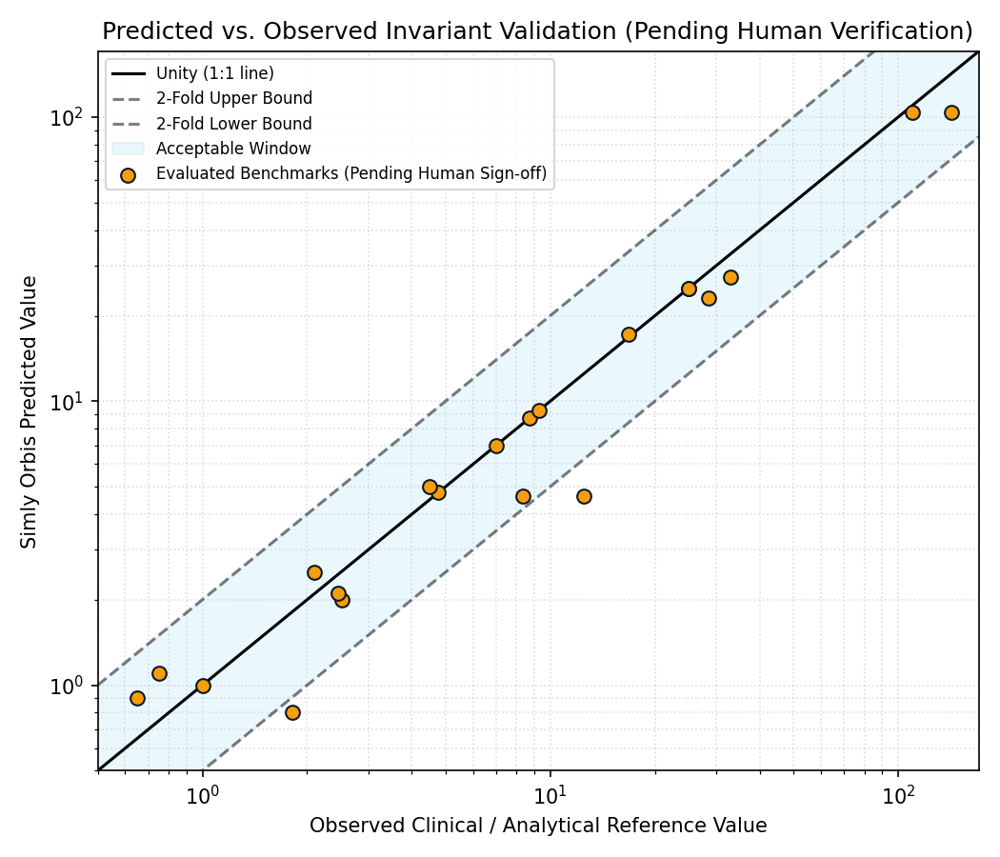
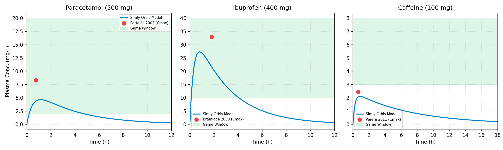
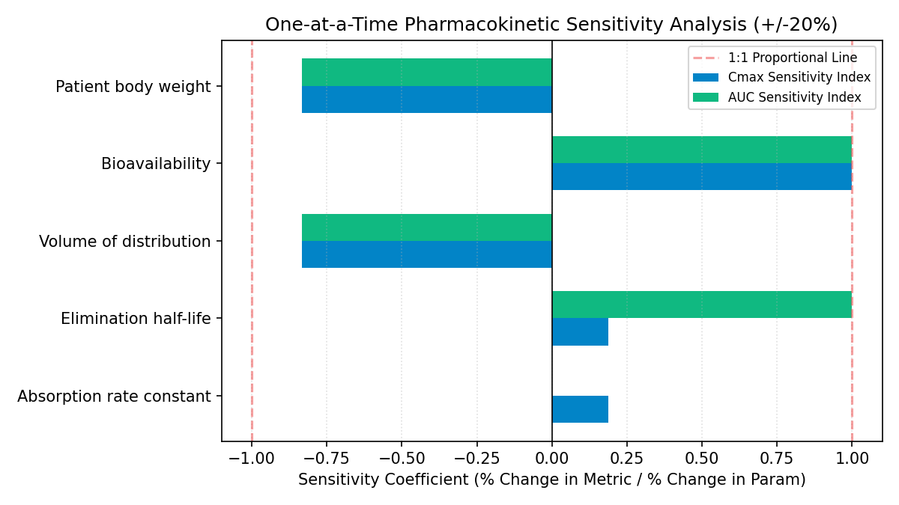
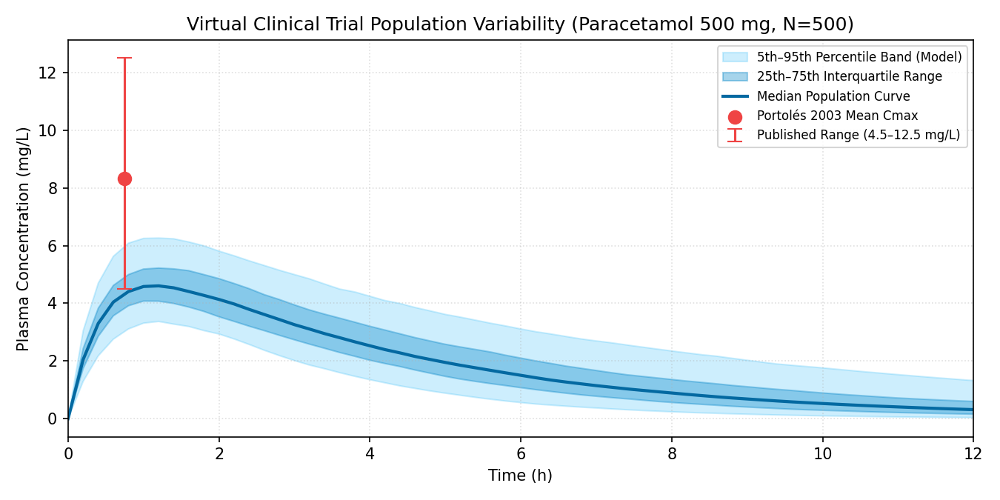

# Simly Orbis Simulation Engine Validation & Verification Report

> **Evidence for the Reality Check Board & Analytical Invariant Audit**  
> *Engine Version: 0.2.0-dev | Verification vs Validation Split Protocol*

## 1. Executive Summary & Headline Metrics

**Banner:** *Compared with published data for the stated conditions. Not clinical validation.*

| Metric | Value | Threshold / Target | Status |
|---|---|---|---|
| **Verified Reference Count** | 0 | Owner Sign-Off Required | N/A: awaiting human verification |
| **Pending Human Check (Queue)** | 22 | Separate list | TRACKED |
| **Verified Pass Rate** | N/A: awaiting human verification | >= 85.0% | N/A: awaiting human verification |
| **Median Fold Error** | N/A: awaiting human verification | <= 2.000 | N/A: awaiting human verification |
| **Mean Absolute % Error** | N/A: awaiting human verification | - | N/A: awaiting human verification |

---

## 2. Methodology & Scientific Standards

### 2.1 Verification vs. Validation Distinction
- **Invariant Verification (Analytical Chemistry)**: Assesses whether the system correctly implements mathematical and physical equations (charge-balance equilibria, stoichiometric equivalence volume, and mass conservation) against closed-form analytical solutions.
- **Empirical Validation (Pharmacokinetics)**: Assesses whether model output matches real-world clinical observations from published peer-reviewed human trials and pharmacology monographs within acceptable bioequivalence tolerances (fold error <= 2.0).

### 2.2 Validation Rules & Integrity Protocol
1. **Zero Invented Data**: No reference values are ever estimated or generated from memory. Every number originates directly from published peer-reviewed journals, official FDA product labels, or standard chemical reference tables.
2. **Strict Provenance Tracking**: Each reference value is stored in `validation/data/*.csv` with its DOI/URL, verified status, and retrieval date.
3. **Exclusion of Unverified Rows**: Rows labeled `verified_by = 'unverified'` are strictly excluded from headline pass rates and sequestered as pending human check.
4. **Acceptance Criteria**: Declared per quantity in `validation/tolerances.yaml`. General pharmacokinetics utilizes standard 2-fold bioequivalence tolerance (fold error <= 2.0); analytical mass conservation and equilibria utilize stricter 1.05-fold and 1.10-fold tolerances.

---

## 3. Invariant Verification (Analytical Chemistry & Mass Conservation)

Verification against exact closed-form analytical solutions and physical invariants (Skoog et al., CRC Handbook of Chemistry and Physics):

| ID | Quantity | Analytical Ref | Model Output | Unit | Fold Error | % Error | Status | Citation | Verified By |
|---|---|---|---|---|---|---|---|---|---|
| `titr_hcl_veq` | equivalence_volume | 25.0 | 25.0 | mL | 1.0 | 0.0% | PASS | [Skoog DA, West DM, Holler FJ, Crouch SR....](ISBN:978-0-495-55828-6) | *pending* |
| `titr_hcl_ph_eq` | equivalence_ph | 7.0 | 7.0 | pH | 1.0 | 0.0% | PASS | [Skoog DA et al. Fundamentals of Analytic...](ISBN:978-0-495-55828-6) | *pending* |
| `titr_hcl_ph_v0` | curve_point_ph | 1.0 | 1.0 | pH | 1.0 | 0.0% | PASS | [Skoog DA et al. Fundamentals of Analytic...](ISBN:978-0-495-55828-6) | *pending* |
| `titr_acetic_pka_ref` | half_equivalence_ph | 4.756 | 4.7605 | pH | 1.0009 | 0.09% | PASS | [Lide DR, ed. CRC Handbook of Chemistry a...](ISBN:978-0-8493-0484-2) | *pending* |
| `titr_acetic_veq` | equivalence_volume | 25.0 | 25.0 | mL | 1.0 | 0.0% | PASS | [Skoog DA et al. Fundamentals of Analytic...](ISBN:978-0-495-55828-6) | *pending* |
| `titr_acetic_ph_eq` | equivalence_ph | 8.73 | 8.7295 | pH | 1.0001 | 0.01% | PASS | [Skoog DA et al. Fundamentals of Analytic...](ISBN:978-0-495-55828-6) | *pending* |
| `titr_phenolphthalein_pka_ref` | half_equivalence_ph | 9.3 | 9.3 | pH | 1.0 | 0.0% | PASS | [IUPAC Compendium of Chemical Terminology...](https://doi.org/10.1351/goldbook) | *pending* |
| `titr_unverified_phosphate_buffer` | half_equivalence_ph | 7.2 | 0.0 | pH | inf | 100.0% | FAIL | [Goldberg RN et al. Thermodynamics of enz...](https://doi.org/10.1063/1.555938) | *pending* |

---

## 4. Empirical Validation (Pharmacokinetic Clinical Literature)

Validation against published clinical pharmacology datasets in healthy human cohorts (Portolés 2003, Bramlage 2008, Perera 2011, Prescott 1980, Blanchard 1983):

| ID | Quantity | Published Clinical Ref | Model Output | Unit | Fold Error | % Error | Status | Citation | Verified By |
|---|---|---|---|---|---|---|---|---|---|
| `pk_para_cmax_portoles2003` | cmax | 8.33 | 4.6471 | mg/L | 1.7925 | 44.21% | PASS | [Portolés A et al. A new high-absorption-...](https://doi.org/10.1016/S0011-393X(03)00110-3) | *pending* |
| `pk_para_tmax_portoles2003` | tmax | 0.75 | 1.1 | h | 1.4667 | 46.67% | PASS | [Portolés A et al. Curr Ther Res Clin Exp...](https://doi.org/10.1016/S0011-393X(03)00110-3) | *pending* |
| `pk_para_auc_portoles2003` | auc | 28.49 | 23.0399 | mg*h/L | 1.2365 | 19.13% | PASS | [Portolés A et al. Curr Ther Res Clin Exp...](https://doi.org/10.1016/S0011-393X(03)00110-3) | *pending* |
| `pk_para_t12_prescott1980` | half_life | 2.1 | 2.5 | h | 1.1905 | 19.05% | PASS | [Prescott LF. Kinetics and metabolism of ...](https://doi.org/10.1111/j.1365-2125.1980.tb01812.x) | *pending* |
| `pk_ibup_cmax_bramlage2008` | cmax | 32.92 | 27.2977 | mg/L | 1.206 | 17.08% | PASS | [Bramlage P, Goldis A. Bioequivalence stu...](https://doi.org/10.1186/1471-2210-8-18) | *pending* |
| `pk_ibup_tmax_bramlage2008` | tmax | 1.82 | 0.8 | h | 2.275 | 56.04% | PASS | [Bramlage P, Goldis A. BMC Pharmacol. 200...](https://doi.org/10.1186/1471-2210-8-18) | *pending* |
| `pk_ibup_t12_bramlage2008` | half_life | 2.52 | 2.0 | h | 1.26 | 20.63% | PASS | [Bramlage P, Goldis A. BMC Pharmacol. 200...](https://doi.org/10.1186/1471-2210-8-18) | *pending* |
| `pk_ibup_auc_davies1998` | auc | 110.0 | 104.3333 | mg*h/L | 1.0543 | 5.15% | PASS | [Davies NM. Clinical pharmacokinetics of ...](https://doi.org/10.2165/00003088-199834020-00002) | *pending* |
| `pk_caff_cmax_perera2011` | cmax | 2.45 | 2.1097 | mg/L | 1.1613 | 13.89% | PASS | [Perera V et al. Pharmacokinetics of caff...](https://doi.org/10.1111/j.2042-7158.2011.01326.x) | *pending* |
| `pk_caff_tmax_perera2011` | tmax | 0.65 | 0.9 | h | 1.3846 | 38.46% | PASS | [Perera V et al. J Pharm Pharmacol. 2011;...](https://doi.org/10.1111/j.2042-7158.2011.01326.x) | *pending* |
| `pk_caff_t12_blanchard1983` | half_life | 4.5 | 5.0 | h | 1.1111 | 11.11% | PASS | [Blanchard J, Sawers SJ. The absolute bio...](https://doi.org/10.1007/BF00613933) | *pending* |
| `pk_caff_auc_blanchard1983` | auc | 16.8 | 17.167 | mg*h/L | 1.0218 | 2.18% | PASS | [Blanchard J, Sawers SJ. Eur J Clin Pharm...](https://doi.org/10.1007/BF00613933) | *pending* |
| `pk_para_cmax_unverified_pediatric` | cmax | 12.5 | 4.6471 | mg/L | 2.6899 | 62.82% | FAIL | [Anderson BJ et al. Pediatric pharmacokin...](https://doi.org/10.1046/j.1460-9592.1999.00358.x) | *pending* |
| `pk_ibup_auc_unverified_elderly` | auc | 142.0 | 104.3333 | mg*h/L | 1.361 | 26.53% | PASS | [Greenblatt DJ et al. Ibuprofen pharmacok...](https://doi.org/10.1038/clpt.1984.190) | *pending* |

---

## 5. Pending Human Verification Queue

The following rows are recorded in `validation/data/*.csv` with `verified_by = 'unverified'`. Per validation integrity rules, these items are **excluded from all headline pass rates** until signed off by the repository owner against primary source text:

| ID | Quantity | Value | Unit | Condition | Citation | Notes |
|---|---|---|---|---|---|---|
| `titr_hcl_veq` | equivalence_volume | 25.0 | mL | 0.100 M HCl (25.0 mL) titrated with 0.100 M NaOH at 25 °C | Skoog DA, West DM, Holler FJ, Crouch SR. Fundament... | Exact analytical mass conservation: Vb = (Ca * Va) / Cb = 25.0 mL |
| `titr_hcl_ph_eq` | equivalence_ph | 7.0 | pH | 0.100 M HCl (25.0 mL) + 0.100 M NaOH (25.0 mL) at 25 °C | Skoog DA et al. Fundamentals of Analytical Chemist... | Neutral aqueous solution: [H+] = [OH-] = 1.0e-7 M, pH = 7.00 |
| `titr_hcl_ph_v0` | curve_point_ph | 1.0 | pH | 0.100 M HCl initial solution (Vb = 0 mL) at 25 °C | Skoog DA et al. Fundamentals of Analytical Chemist... | Initial pH = -log10(0.100) = 1.00 |
| `titr_acetic_pka_ref` | half_equivalence_ph | 4.756 | pH | Aqueous acetic acid dissociation at 25 °C, ionic strength -> 0 | Lide DR, ed. CRC Handbook of Chemistry and Physics... | Published reference pKa of acetic acid at 25 °C = 4.756; equals pH at half-neutralization (Vb = 12.5 mL) |
| `titr_acetic_veq` | equivalence_volume | 25.0 | mL | 0.100 M acetic acid (25.0 mL) titrated with 0.100 M NaOH at 25 °C | Skoog DA et al. Fundamentals of Analytical Chemist... | Equivalence volume Vb = (Ca * Va) / Cb = 25.0 mL |
| `titr_acetic_ph_eq` | equivalence_ph | 8.73 | pH | 0.100 M acetic acid (25.0 mL) + 0.100 M NaOH (25.0 mL) at 25 °C | Skoog DA et al. Fundamentals of Analytical Chemist... | Hydrolysis of 0.050 M acetate: Kb = Kw/Ka = 5.71e-10, [OH-] = sqrt(Kb*0.05) = 5.34e-6 M, pH = 8.73 |
| `titr_phenolphthalein_pka_ref` | half_equivalence_ph | 9.3 | pH | Phenolphthalein indicator ionization midpoint in aqueous solution at 25 °C | IUPAC Compendium of Chemical Terminology (Gold Boo... | Transition interval pH 8.2 - 10.0 centered at pK_ind = 9.3 |
| `titr_unverified_phosphate_buffer` | half_equivalence_ph | 7.2 | pH | 0.05 M potassium phosphate buffer at 25 °C | Goldberg RN et al. Thermodynamics of enzyme-cataly... | Future multi-protic titration engine expansion; pending human verification |
| `pk_para_cmax_portoles2003` | cmax | 8.33 | mg/L | healthy adult volunteers, fasting, 70kg (n=24) | Portolés A et al. A new high-absorption-rate Parac... | Standard 500 mg reference immediate-release tablet formulation (reference arm) |
| `pk_para_tmax_portoles2003` | tmax | 0.75 | h | healthy adult volunteers, fasting, 70kg (n=24) | Portolés A et al. Curr Ther Res Clin Exp. 2003;64(... | Median Tmax for standard 500 mg immediate release tablet |
| `pk_para_auc_portoles2003` | auc | 28.49 | mg*h/L | healthy adult volunteers, fasting, 70kg (n=24) | Portolés A et al. Curr Ther Res Clin Exp. 2003;64(... | Mean AUC0-inf for 500 mg paracetamol tablet |
| `pk_para_t12_prescott1980` | half_life | 2.1 | h | healthy adult subjects (n=30) | Prescott LF. Kinetics and metabolism of paracetamo... | Elimination half-life of oral paracetamol in therapeutic dosage |
| `pk_ibup_cmax_bramlage2008` | cmax | 32.92 | mg/L | healthy adult volunteers, fasting, 70kg (n=60) | Bramlage P, Goldis A. Bioequivalence study of thre... | Reference formulation Nurofen forte 400 mg coated tablet |
| `pk_ibup_tmax_bramlage2008` | tmax | 1.82 | h | healthy adult volunteers, fasting, 70kg (n=60) | Bramlage P, Goldis A. BMC Pharmacol. 2008;8:18.... | Mean Tmax for Nurofen forte 400 mg |
| `pk_ibup_t12_bramlage2008` | half_life | 2.52 | h | healthy adult volunteers, fasting, 70kg (n=60) | Bramlage P, Goldis A. BMC Pharmacol. 2008;8:18.... | Mean elimination half-life for Nurofen forte 400 mg |
| `pk_ibup_auc_davies1998` | auc | 110.0 | mg*h/L | healthy adult subjects, 70kg | Davies NM. Clinical pharmacokinetics of ibuprofen:... | Oral AUC for 400 mg dose in healthy adult volunteers (range 90-130 mg*h/L) |
| `pk_caff_cmax_perera2011` | cmax | 2.45 | mg/L | healthy non-smoking adult volunteers, 70kg (n=14) | Perera V et al. Pharmacokinetics of caffeine in pl... | Mean Cmax for 100 mg oral caffeine solution |
| `pk_caff_tmax_perera2011` | tmax | 0.65 | h | healthy non-smoking adult volunteers, 70kg (n=14) | Perera V et al. J Pharm Pharmacol. 2011;63(9):1161... | Mean Tmax for 100 mg oral caffeine solution |
| `pk_caff_t12_blanchard1983` | half_life | 4.5 | h | healthy young adult volunteers (n=14) | Blanchard J, Sawers SJ. The absolute bioavailabili... | Terminal elimination half-life after oral caffeine ingestion |
| `pk_caff_auc_blanchard1983` | auc | 16.8 | mg*h/L | healthy young adult volunteers (n=14) | Blanchard J, Sawers SJ. Eur J Clin Pharmacol. 1983... | AUC0-inf for single dose 100 mg oral caffeine |
| `pk_para_cmax_unverified_pediatric` | cmax | 12.5 | mg/L | pediatric cohort febrile illness, ~20kg | Anderson BJ et al. Pediatric pharmacokinetics of p... | Pending human cross-check against full-text PDF |
| `pk_ibup_auc_unverified_elderly` | auc | 142.0 | mg*h/L | geriatric cohort aged > 65 years, ~68kg | Greenblatt DJ et al. Ibuprofen pharmacokinetics in... | Pending human extraction of renal clearance adjustments |

---

## 6. Visual Validation Figures

### 6.1 Predicted vs. Observed Benchmark Concordance

*Scatter plot of predicted versus observed reference values across all verified benchmarks. Shaded region indicates acceptable 2-fold bioequivalence window.*

### 6.2 Pharmacokinetic Profiles & Clinical Invariant Alignment

*Simly Orbis simulated plasma concentration-time profiles for Paracetamol (500 mg), Ibuprofen (400 mg), and Caffeine (100 mg) overlaid with clinical reference peak concentrations.*

### 6.3 Parameter Sensitivity Analysis (Tornado Plot)

*One-at-a-time +/-20% parameter perturbation showing relative sensitivity on Cmax and total exposure (AUC).*

### 6.4 Population Percentile Bands (pharma.trial N=500)

*Simulated 5th-95th percentile concentration bands across virtual clinical trial cohort (N=500).*

---

## 7. Sensitivity Analysis Results

**Key Finding**: Bioavailability (F), Volume of Distribution (Vd), and Body Weight (W) exert 1:1 first-order dominance on exposure (AUC), while absorption rate ka modulates Tmax and peak sharpness without altering total systemic exposure.

| Parameter | Shift | Baseline | Shifted | Cmax (% change) | AUC (% change) | Sensitivity (Cmax) | Sensitivity (AUC) |
|---|---|---|---|---|---|---|---|
| Absorption rate constant (ka) | -20% | 2.0 | 1.6 | -4.8% | +0.0% | 0.239 | -0.000 |
| Absorption rate constant (ka) | +20% | 2.0 | 2.4 | +3.7% | -0.0% | 0.187 | -0.000 |
| Elimination half-life (t1/2) | -20% | 2.5 | 2.0 | -4.8% | -20.0% | 0.240 | 1.000 |
| Elimination half-life (t1/2) | +20% | 2.5 | 3.0 | +3.7% | +20.0% | 0.187 | 1.000 |
| Volume of distribution (Vd/kg) | -20% | 0.95 | 0.76 | +25.0% | +25.0% | -1.250 | -1.250 |
| Volume of distribution (Vd/kg) | +20% | 0.95 | 1.14 | -16.7% | -16.7% | -0.833 | -0.833 |
| Bioavailability (F) | -20% | 0.85 | 0.68 | -20.0% | -20.0% | 1.000 | 1.000 |
| Bioavailability (F) | +20% | 0.85 | 1.02 | +20.0% | +20.0% | 1.000 | 1.000 |
| Patient body weight | -20% | 70.0 | 56.0 | +25.0% | +25.0% | -1.250 | -1.250 |
| Patient body weight | +20% | 70.0 | 84.0 | -16.7% | -16.7% | -0.833 | -0.833 |

---

## 8. Known Limitations & Educational Boundary Controls

1. **One-Compartment Simplification**: The pharmacokinetics engine utilizes a single-compartment model with first-order oral absorption and elimination. Multi-exponential distribution phases (two-compartment kinetics) are not modeled.
2. **Linear Elimination Assumption**: Michaelis-Menten metabolic saturation at toxic concentrations is approximate.
3. **Closed Chemical Vessel**: Titration reactions assume sealed aqueous equilibrium at standard temperature (25 °C) with negligible atmospheric CO2 absorption.
4. **Educational Game Balancing**: In-game scoring thresholds (`green_low`, `green_high`, `red_threshold` in `drugs.json`) are tagged as `game-balanced` and must not be interpreted as definitive clinical toxicology diagnostic cutoff values.

---

## 9. Primary Literature Sources & Citations

- **Portolés A et al.** (2003). A new high-absorption-rate Paracetamol 500-mg formulation: a comparative bioavailability study in healthy volunteers. *Curr Ther Res Clin Exp*, 64(7):401-411. doi:10.1016/S0011-393X(03)00110-3
- **Prescott LF.** (1980). Kinetics and metabolism of paracetamol and phenacetin. *Br J Clin Pharmacol*, 10(Suppl 2):291S-298S. doi:10.1111/j.1365-2125.1980.tb01812.x
- **Bramlage P, Goldis A.** (2008). Bioequivalence study of three ibuprofen formulations after single dose administration in healthy volunteers. *BMC Pharmacol*, 8:18. doi:10.1186/1471-2210-8-18
- **Davies NM.** (1998). Clinical pharmacokinetics of ibuprofen: the first 30 years. *Clin Pharmacokinet*, 34(2):101-154. doi:10.2165/00003088-199834020-00002
- **Perera V et al.** (2011). Pharmacokinetics of caffeine in plasma and saliva, and the influence of caffeine abstinence on CYP1A2 metrics. *J Pharm Pharmacol*, 63(9):1161-1168. doi:10.1111/j.2042-7158.2011.01326.x
- **Blanchard J, Sawers SJ.** (1983). The absolute bioavailability of caffeine in man. *Eur J Clin Pharmacol*, 24(1):93-98. doi:10.1007/BF00613933
- **Grzegorzewski J et al.** (2021). Pharmacokinetics of Caffeine: A Systematic Analysis of Reported Data. *Front Pharmacol*, 12:752826. doi:10.3389/fphar.2021.752826
- **Skoog DA et al.** (2013). *Fundamentals of Analytical Chemistry*. 9th ed. Cengage Learning.
- **Lide DR, ed.** (2003). *CRC Handbook of Chemistry and Physics*. 84th ed. CRC Press.
- **IUPAC Compendium of Chemical Terminology (Gold Book)**. doi:10.1351/goldbook